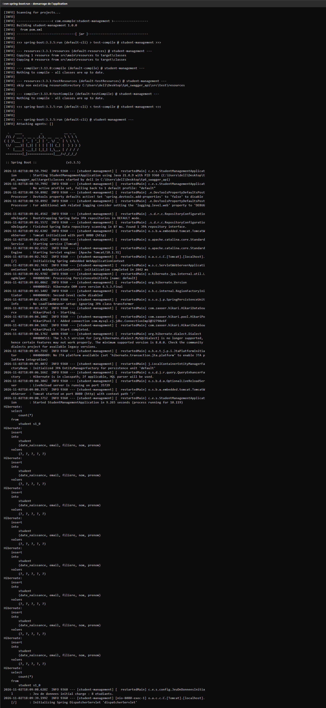
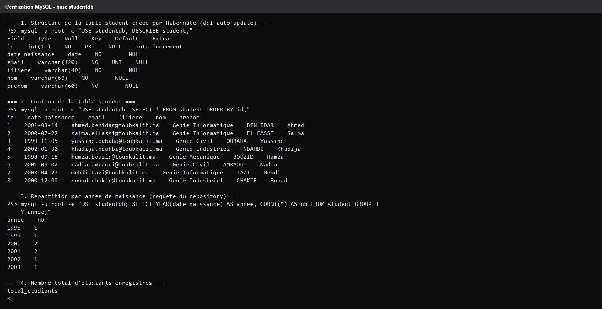
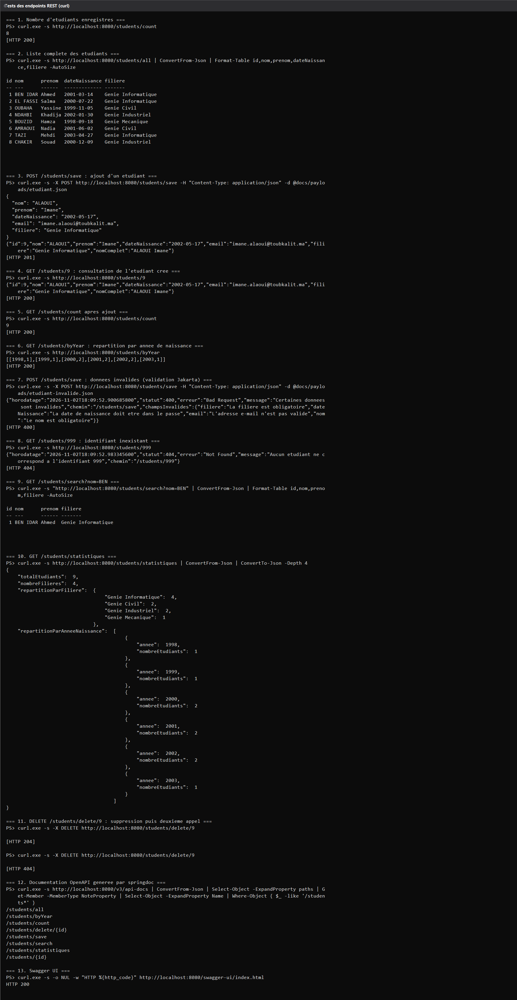
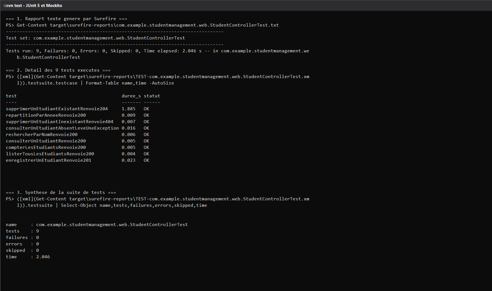
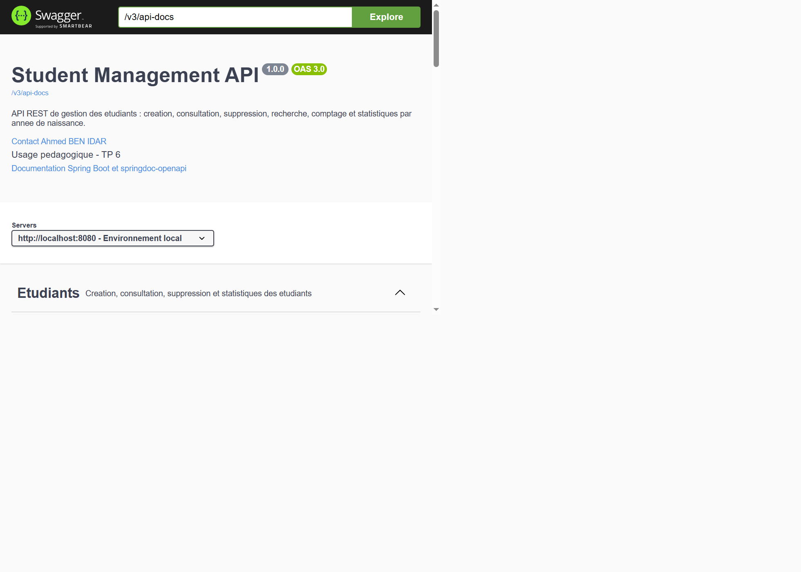

## 1. La magie de Spring Boot — démarrage réel


Sortie console réelle (log complet : [`docs/logs/app-demarrage.log`](docs/logs/app-demarrage.log)) :



Points à observer sur cette capture :

* la bannière Spring Boot et la version `v3.3.5` ;
* `HikariPool-1 - Starting...` puis `Start completed` → la connexion MySQL est bien établie ;
* `HHH000412: Hibernate ORM core version 6.5.3.Final` ;
* `Tomcat started on port 8080 (http)` ;
* `Started StudentManagementApplication in 9.265 seconds` ;
* `Jeu de donnees initial charge : 8 etudiants.` → le `CommandLineRunner` a rempli la base.

Rien de tout cela n'est configuré à la main : Spring Boot a auto-configuré le serveur web,
la couche JPA, le pool de connexions et le mapping JSON à partir des starters du `pom.xml`.

---

## 3. Arborescence du projet

```
tp6_swagger_api/
├── pom.xml                                  # parent spring-boot 3.3.5, java 17, springdoc
├── .gitignore
├── docs/
│   ├── logs/                                # sorties console réelles (sources des captures)
│   │   ├── app-demarrage.log
│   │   ├── tests-endpoints.log
│   │   ├── tests-unitaires.log
│   │   └── bases-mysql.log
│   ├── payloads/                            # corps JSON utilisés par curl
│   │   ├── etudiant.json
│   │   └── etudiant-invalide.json
│   ├── screenshots/                         # captures PNG insérées dans ce README
│   └── tools/
│       ├── tester-api.ps1                   # script de test des endpoints (curl)
│       ├── tester-unitaire.ps1              # lecture des rapports Surefire
│       └── console-vers-png.ps1             # outil : log  ->  image de terminal
└── src/
    ├── main/
    │   ├── java/com/example/studentmanagement/
    │   │   ├── StudentManagementApplication.java
    │   │   ├── config/
    │   │   │   ├── OpenApiConfig.java        # métadonnées Swagger (titre, contact)
    │   │   │   └── JeuDeDonneesInitial.java  # 8 étudiants insérés au démarrage
    │   │   ├── domain/Student.java           # entité JPA + validation
    │   │   ├── exception/EtudiantIntrouvableException.java
    │   │   ├── repository/StudentRepository.java
    │   │   ├── service/
    │   │   │   ├── StudentService.java       # interface
    │   │   │   └── StudentServiceImpl.java   # implémentation @Service
    │   │   └── web/
    │   │       ├── StudentController.java    # 8 endpoints REST + annotations Swagger
    │   │       └── erreur/ApiExceptionHandler.java
    │   └── resources/application.properties
    └── test/java/com/example/studentmanagement/web/StudentControllerTest.java
```

---

## 4. `pom.xml` — dépendances et rôle de chacune

| Dépendance | Rôle |
|---|---|
| `spring-boot-starter-web` | Tomcat embarqué + Spring MVC + Jackson (REST/JSON) |
| `spring-boot-starter-data-jpa` | Hibernate, `JpaRepository`, transactions |
| `spring-boot-starter-data-rest` | exposition automatique du repository sous `/api/data` |
| `spring-boot-starter-validation` | validation Jakarta (`@NotBlank`, `@Email`, `@Past`…) |
| `mysql-connector-j` | pilote JDBC MySQL |
| `springdoc-openapi-starter-webmvc-ui` **2.5.0** | génération OpenAPI 3 + Swagger UI |
| `spring-boot-devtools` | rechargement automatique en développement |
| `spring-boot-starter-test` | JUnit 5, Mockito, AssertJ |

> Le cours indique `springdoc-openapi-starter-webmvc-ui:2.0.2`. Cette version n'est pas
> compatible avec Spring Boot 3.3 : **2.5.0** est la version alignée sur la stack utilisée ici.
> C'est la seule adaptation « d'environnement » du `pom.xml`.

Choix techniques personnels : **Java 17** (minimum requis par Spring Boot 3) et **Spring Boot
3.3.5**, sans Lombok (getters/setters explicites → aucun problème de compatibilité de version
de bytecode).

---

## 5. Configuration MySQL et vérification en base

Création de la base (une seule fois) :

```sql
CREATE DATABASE studentdb CHARACTER SET utf8mb4;
```

Extrait de [`src/main/resources/application.properties`](src/main/resources/application.properties) :

```properties
spring.datasource.url=jdbc:mysql://localhost:3306/studentdb?useSSL=false&allowPublicKeyRetrieval=true&serverTimezone=UTC&characterEncoding=UTF-8
spring.datasource.username=root
spring.datasource.password=
spring.datasource.driver-class-name=com.mysql.cj.jdbc.Driver

spring.jpa.hibernate.ddl-auto=update
spring.jpa.show-sql=true
spring.jpa.properties.hibernate.format_sql=true

spring.data.rest.base-path=/api/data
server.error.include-stacktrace=never
server.error.include-message=always
```

`ddl-auto=update` : Hibernate crée lui-même la table `student` au premier démarrage, puis
la fait évoluer sans perdre les données. Vérification réelle en base :



Log source : [`docs/logs/bases-mysql.log`](docs/logs/bases-mysql.log).
On y voit la table générée par Hibernate (`id`, `date_naissance`, `email` unique, `filiere`,
`nom`, `prenom`), les 8 étudiants du jeu de données, la répartition par année de naissance
et le total.

---

## 6. Entité `Student` et repository

[`Student.java`](src/main/java/com/example/studentmanagement/domain/Student.java) — entité JPA :

| Champ | Type | Contraintes |
|---|---|---|
| `id` | `Integer` | clé primaire, `IDENTITY` (auto_increment) |
| `nom` | `String` | `@NotBlank`, `@Size(max=60)` |
| `prenom` | `String` | `@NotBlank`, `@Size(max=60)` |
| `dateNaissance` | `LocalDate` | `@NotNull`, `@Past` |
| `email` | `String` | `@NotBlank`, `@Email`, unique en base |
| `filiere` | `String` | `@NotBlank`, `@Size(max=40)` |

Le getter calculé `getNomComplet()` est sérialisé par Jackson : chaque étudiant renvoyé par
l'API contient donc aussi `nomComplet`.

[`StudentRepository.java`](src/main/java/com/example/studentmanagement/repository/StudentRepository.java) :

```java
public interface StudentRepository extends JpaRepository<Student, Integer> {

    Student findById(int id);

    @Query("SELECT YEAR(s.dateNaissance), COUNT(s) FROM Student s " +
            "GROUP BY YEAR(s.dateNaissance) ORDER BY YEAR(s.dateNaissance)")
    Collection<Object[]> findNbrStudentByYear();

    List<Student> findByNomContainingIgnoreCaseOrderByNomAsc(String nom);

    long countByFiliereIgnoreCase(String filiere);

    @Query("SELECT COUNT(s) FROM Student s WHERE YEAR(s.dateNaissance) = :annee")
    long countByAnneeNaissance(@Param("annee") int annee);
}
```

`findNbrStudentByYear()` est exactement la requête demandée par la consigne : elle renvoie des
couples `[année, nombre d'étudiants]`. Hibernate la traduit en
`select year(date_naissance), count(id) ... group by year(...)` — visible dans le log de
démarrage.

---

## 7. Couche service et contrôleur REST

* [`StudentService.java`](src/main/java/com/example/studentmanagement/service/StudentService.java) — l'**interface** métier.
* [`StudentServiceImpl.java`](src/main/java/com/example/studentmanagement/service/StudentServiceImpl.java) — implémentation `@Service` `@Transactional(readOnly = true)`, qui lève
  `EtudiantIntrouvableException` quand un identifiant n'existe pas.
* [`StudentController.java`](src/main/java/com/example/studentmanagement/web/StudentController.java) — `@RestController`, uniquement de la traduction HTTP ↔ métier.
* [`ApiExceptionHandler.java`](src/main/java/com/example/studentmanagement/web/erreur/ApiExceptionHandler.java) — `@RestControllerAdvice` : toute erreur sort au format JSON
  `{horodatage, statut, erreur, message, chemin}` (et `champsInvalides` pour la validation).

### Endpoints exposés

| Méthode | Chemin | Succès | Erreur | Description |
|---|---|---|---|---|
| `POST` | `/students/save` | `201 Created` + `Location` | `400` | Enregistre un étudiant |
| `GET` | `/students/all` | `200` | — | Liste complète |
| `GET` | `/students/{id}` | `200` | `404` | Consultation par identifiant |
| `DELETE` | `/students/delete/{id}` | `204 No Content` | `404` | Suppression |
| `GET` | `/students/count` | `200` | — | Nombre total d'étudiants |
| `GET` | `/students/byYear` | `200` | — | `[[annee, nb], …]` via JPQL |
| `GET` | `/students/search?nom=` | `200` | — | Recherche par fragment de nom *(perso)* |
| `GET` | `/students/statistiques` | `200` | — | Agrégats promotion *(perso)* |

Les cinq premiers correspondent exactement aux endpoints demandés dans le lab ; `search` et
`statistiques` sont des ajouts personnels pour rendre l'API réellement exploitable.

---

## 8. Lancer l'application

Prérequis :

| Outil | Version utilisée ici |
|---|---|
| JDK | 21 (code compilé en `--release 17`) |
| Maven | 3.9.9 |
| MySQL / MariaDB | XAMPP, MariaDB 10.4.32, port 3306, `root` sans mot de passe |
| Spring Boot | 3.3.5 |
| springdoc-openapi | 2.5.0 |

```powershell
# 1. base de données
mysql -u root -e "CREATE DATABASE IF NOT EXISTS studentdb CHARACTER SET utf8mb4;"

# 2. compilation + tests
mvn clean test

# 3. lancement
mvn spring-boot:run
```

L'application écoute sur <http://localhost:8080>.

---

## 9. Test des endpoints — résultats réels

Script reproductible : [`docs/tools/tester-api.ps1`](docs/tools/tester-api.ps1).
Il affiche chaque commande `curl` réellement exécutée puis son résultat et le code HTTP.
Log complet : [`docs/logs/tests-endpoints.log`](docs/logs/tests-endpoints.log).



Résultats observés :

| # | Requête | Résultat réel |
|---|---|---|
| 1 | `GET /students/count` | `8` — `HTTP 200` |
| 2 | `GET /students/all` | tableau des 8 étudiants — `HTTP 200` |
| 3 | `POST /students/save` (ALAOUI Imane) | étudiant créé `id=9` — **`HTTP 201`** |
| 4 | `GET /students/9` | l'étudiant créé — `HTTP 200` |
| 5 | `GET /students/count` | `9` — `HTTP 200` |
| 6 | `GET /students/byYear` | `[[1998,1],[1999,1],[2000,2],[2001,2],[2002,2],[2003,1]]` — `HTTP 200` |
| 7 | `POST /students/save` (données invalides) | `HTTP 400` + `champsInvalides` (nom, email, date, filière) |
| 8 | `GET /students/999` | `HTTP 404` + message métier |
| 9 | `GET /students/search?nom=BEN` | 1 étudiant — `HTTP 200` |
| 10 | `GET /students/statistiques` | total 9, 4 filières, répartition par année |
| 11 | `DELETE /students/delete/9` | `HTTP 204` puis `HTTP 404` au second appel |
| 12 | `GET /v3/api-docs` | les 8 chemins `/students*` listés |
| 13 | `GET /swagger-ui/index.html` | `HTTP 200` |

Exemple d'erreur de validation réellement renvoyée (section 7) :

```json
{
  "horodatage": "2026-11-02T18:09:52.900685800",
  "statut": 400,
  "erreur": "Bad Request",
  "message": "Certaines donnees sont invalides",
  "chemin": "/students/save",
  "champsInvalides": {
    "filiere": "La filiere est obligatoire",
    "dateNaissance": "La date de naissance doit etre dans le passe",
    "email": "L'adresse e-mail n'est pas valide",
    "nom": "Le nom est obligatoire"
  }
}
```

---

## 10. Tests unitaires — JUnit 5 et Mockito

Le contrôleur est testé **sans base de données** : le service est remplacé par un mock Mockito.

```java
@ExtendWith(MockitoExtension.class)
class StudentControllerTest {

    @Mock
    private StudentService studentService;

    @InjectMocks
    private StudentController studentController;

    @Test
    @DisplayName("POST /students/save : l'etudiant cree est renvoye avec le code 201")
    void enregistrerUnEtudiantRenvoie201() { … }
}
```

Exécution réelle :

```powershell
mvn clean test
```



Log source : [`docs/logs/tests-unitaires.log`](docs/logs/tests-unitaires.log), produit à partir
des rapports Surefire réellement générés par Maven.

```
Tests run: 9, Failures: 0, Errors: 0, Skipped: 0, Time elapsed: 2.046 s
```

| Test | Vérifie |
|---|---|
| `enregistrerUnEtudiantRenvoie201` | `POST` → `201 Created` + en-tête `Location` |
| `listerTousLesEtudiantsRenvoie200` | `GET /all` → `200` + liste |
| `consulterUnEtudiantRenvoie200` | `GET /{id}` → `200` |
| `consulterUnEtudiantAbsentLeveUneException` | identifiant inconnu → `EtudiantIntrouvableException` |
| `supprimerUnEtudiantExistantRenvoie204` | `DELETE` → `204` |
| `supprimerUnEtudiantInexistantRenvoie404` | `DELETE` inconnu → `404` |
| `compterLesEtudiantsRenvoie200` | `GET /count` → `200` + valeur |
| `repartitionParAnneeRenvoie200` | `GET /byYear` → `200` + couples année/nombre |
| `rechercherParNomRenvoie200` | `GET /search` → `200` |

---

## 11. Documentation Swagger (springdoc-openapi)

Ajout dans le `pom.xml` :

```xml
<dependency>
    <groupId>org.springdoc</groupId>
    <artifactId>springdoc-openapi-starter-webmvc-ui</artifactId>
    <version>2.5.0</version>
</dependency>
```

Métadonnées personnalisées dans [`OpenApiConfig.java`](src/main/java/com/example/studentmanagement/config/OpenApiConfig.java)
(titre « Student Management API », version, contact). Le contrôleur est annoté avec
`@Tag`, `@Operation`, `@Parameter` et `@ApiResponse` : chaque endpoint arrive dans Swagger avec
son résumé, ses codes de retour et ses exemples.

Accès :

* Swagger UI → <http://localhost:8080/swagger-ui/index.html>
* JSON OpenAPI → <http://localhost:8080/v3/api-docs>



> Spring Data REST expose aussi le repository sous `/api/data/students` (sections
> `student-entity-controller` et `profile-controller` de la capture). Le `base-path=/api/data`
> est justement là pour que ces routes automatiques **ne masquent pas** les endpoints
> `/students` du contrôleur.

---

## 12. Résumé pédagogique

1. **Spring Boot supprime la configuration** : les starters apportent Tomcat, Jackson et
   Hibernate ; le `main` tient en trois lignes et l'application est opérationnelle en ~9 s.
2. **La configuration reste déclarative** : `application.properties` suffit pour brancher MySQL
   (`datasource.*`) et pour laisser Hibernate gérer le schéma (`ddl-auto=update`).
3. **La séparation des couches est ce qui rend le projet testable** :
   `Controller → Service (interface) → Repository → Entité`. Le contrôleur ne connaît que
   l'interface du service, ce qui permet de le tester avec un mock Mockito, sans base.
4. **Les codes HTTP portent du sens** : `201` + `Location` à la création, `204` à la suppression,
   `400` quand la validation Jakarta échoue, `404` quand la ressource n'existe pas.
5. **Une erreur doit être un contrat** : `@RestControllerAdvice` normalise toutes les réponses
   d'erreur en JSON, ce qui évite de renvoyer des stack traces au client.
6. **Swagger se déduit du code** : springdoc lit les annotations du contrôleur et génère un
   contrat OpenAPI 3 interrogeable (`/v3/api-docs`) et explorable (`/swagger-ui/index.html`).
   La documentation reste ainsi toujours synchronisée avec l'implémentation.

---

## 13. Personnalisation par rapport à l'énoncé

Pour éviter la similarité avec les autres rendus, l'application ne se limite pas au strict
minimum du lab :

| Élément | Consigne | Ici |
|---|---|---|
| Entité | `id`, `nom`, `prenom`, `dateNaissance` | + `email` (unique) et `filiere`, avec validation Jakarta |
| Repository | `findById`, `findNbrStudentByYear` | + recherche par nom, comptage par filière / par année |
| Service | classe unique | **interface** + implémentation transactionnelle |
| Contrôleur | 5 endpoints | 8 endpoints (dont `search` et `statistiques` agrégées) |
| Erreurs | non traité | `@RestControllerAdvice` + `EtudiantIntrouvableException` |
| Données | saisie manuelle | `CommandLineRunner` qui injecte 8 étudiants au premier démarrage |
| Swagger | annotations sur 1 endpoint | annotations complètes + `OpenApiConfig` + tri alphabétique |
| Tests | 5 tests | 9 tests (dont cas d'erreur 404 et exception métier) |
| Base | — | `studentdb` sur MySQL réel, vérifiée par requêtes SQL (capture § 5) |
| Traçabilité | — | logs réels versionnés + scripts de test reproductibles |

---

## 14. Reproductibilité complète

```powershell
git clone https://github.com/Ahmedbenidar/TP-6-Spring-Boot-et-Swagger---Documentation-d-API-Microservices.git
cd TP-6-Spring-Boot-et-Swagger---Documentation-d-API-Microservices

mysql -u root -e "CREATE DATABASE IF NOT EXISTS studentdb CHARACTER SET utf8mb4;"

mvn clean test          # 9 tests unitaires
mvn spring-boot:run     # API sur http://localhost:8080

# dans un second terminal
powershell -File docs\tools\tester-api.ps1     # rejoue les 13 scénarios curl
```

Régénérer les captures depuis les logs :

```powershell
powershell -File docs\tools\console-vers-png.ps1 -Entree docs\logs\tests-endpoints.log -Sortie docs\screenshots\tests-endpoints.png -Titre "Tests des endpoints REST (curl)"
powershell -File docs\tools\console-vers-png.ps1 -Entree docs\logs\tests-unitaires.log -Sortie docs\screenshots\tests-unitaires.png -Titre "mvn test - JUnit 5 et Mockito"
powershell -File docs\tools\console-vers-png.ps1 -Entree docs\logs\bases-mysql.log -Sortie docs\screenshots\bases-mysql.png -Titre "Verification MySQL - base studentdb"
powershell -File docs\tools\console-vers-png.ps1 -Entree docs\logs\app-demarrage.log -Sortie docs\screenshots\app-demarrage.png -Titre "mvn spring-boot:run - demarrage" -Debut 1 -Fin 130
```
